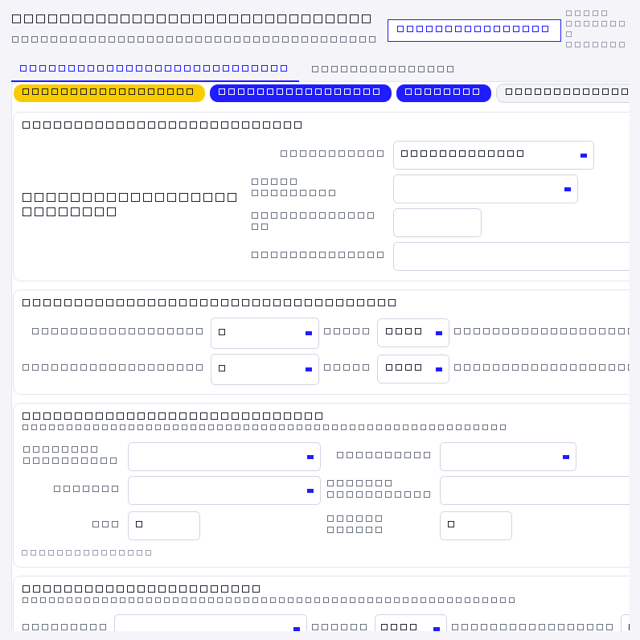
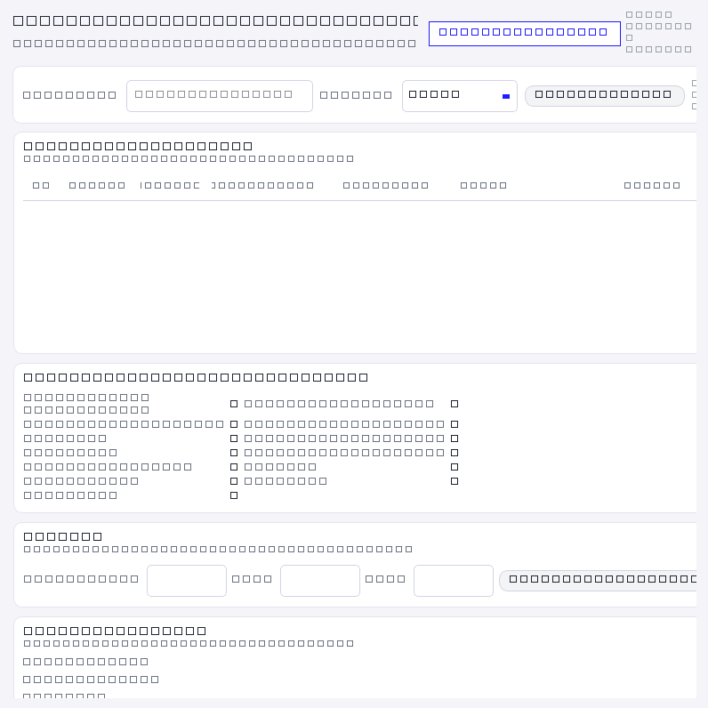
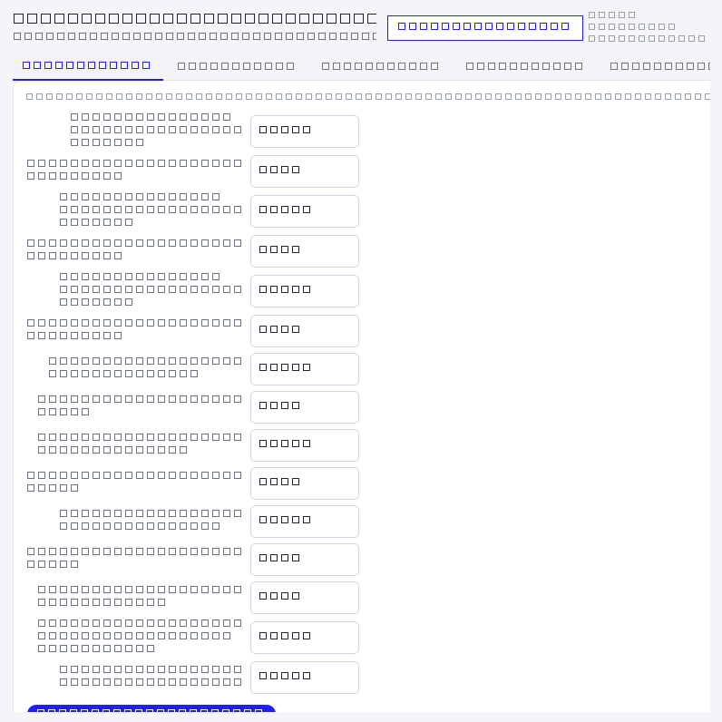
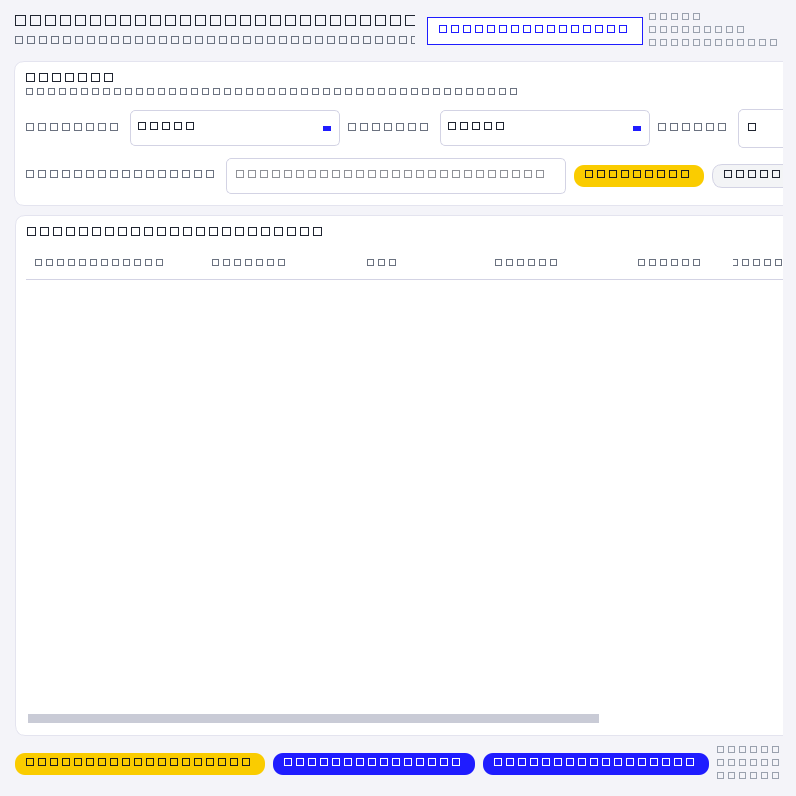
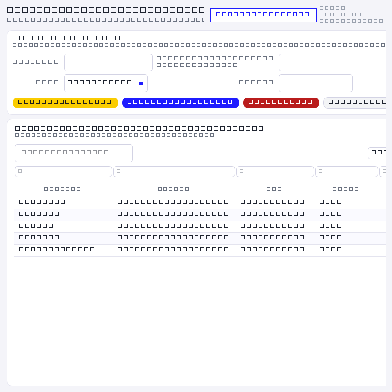
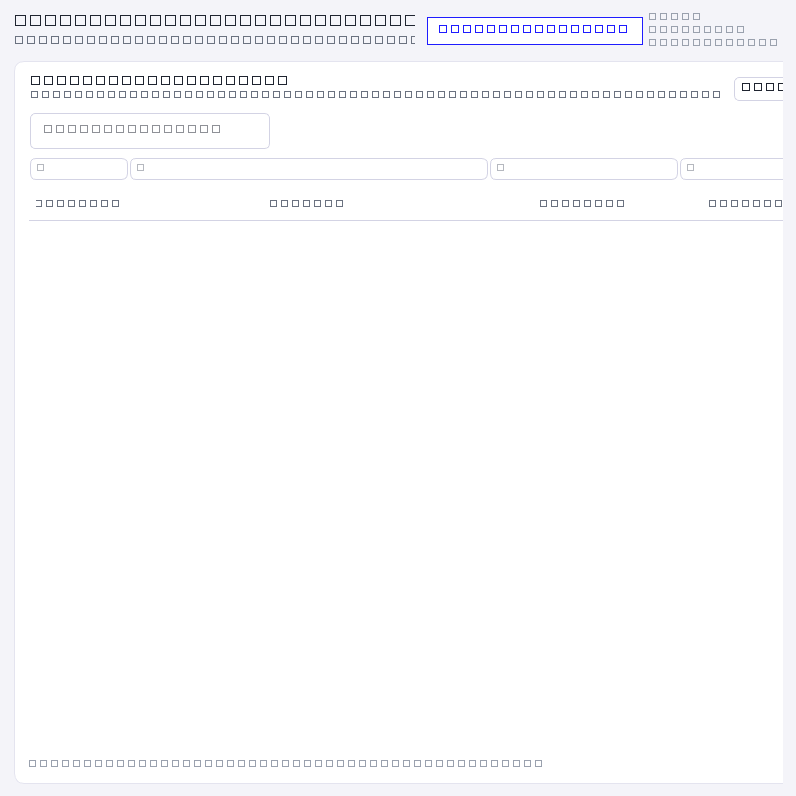
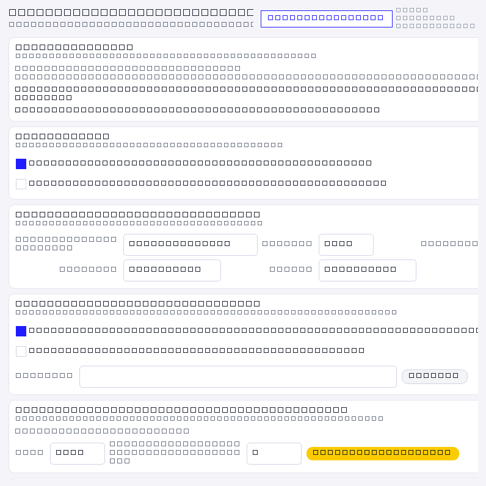

<!--
  Sistema de Viáticos Miempresa
  Autor:    Richard Esteban Salazar Guillén
  Contacto: richards0101789@gmail.com  ·  +593 981239086
  (c) 2026 Richard Esteban Salazar Guillén — Todos los derechos reservados.
-->

# Sistema de Viáticos Miempresa

**Programa de escritorio para registrar, calcular, justificar y controlar los viáticos de viaje de
Miempresa**, pensado para que **varias computadoras trabajen sobre los mismos datos** (base de
datos central), con informes en PDF, exportación a Excel, control de facturas y bitácora de
actividad.


## Funcionalidades

- **Viáticos por día**: comidas, taxis, hospedaje, agua, combustible y peaje, con las tarifas por
  cantón y el **redondeo de cajero** de la empresa.
- **Horas de viaje por ruta**: salida y regreso calculados por cantón, con la tabla de rutas
  **editable** en *Parámetros → Rutas* (incluye el taxi de regreso cuando el regreso es de noche o de
  madrugada).
- **Viático de ajuste**: al ajustar un viático ya hecho **no se vuelve a pedir provincia ni cantón**
  (toma los km del catálogo de distancias).
- **Justificación con facturas**: cada gasto lleva su factura y sale **un solo PDF** con las
  imágenes comprimidas, listo para imprimir.
- **Informes**: PDF con la apariencia de la empresa y **exportación a Excel** por documento
  (*Original*, *Ajuste*, *General*), con las 25 columnas del Excel oficial y la fila de totales.
- **Catálogos**: empleados, clientes, cantones, distancias, tarifas y proveedores, con importación
  desde Excel.
- **Usuarios y permisos**: superusuario para la configuración (conexión, usuarios, respaldos).
- **Bitácora de actividad**: quién hizo qué y cuándo, en todas las pantallas.
- **Respaldos dentro de la base** y restauración desde el propio sistema.
- **Numeración de viáticos sin repetir** aunque trabajen varias PC a la vez.
- **Interfaz que se adapta a cada PC**: zoom propio por computadora, ventanas maximizadas y textos
  en dos líneas para que la *Justificación* entre completa en un monitor de 1080p.

## Capturas

| Viáticos | Justificación |
| --- | --- |
|  |  |

| Parámetros y catálogos | Bitácora |
| --- | --- |
|  |  |

| Usuarios | Respaldos | Conexión a la base |
| --- | --- | --- |
|  |  |  |

## Requisitos

- **Windows 10/11** (probado en 64 bits).
- **Python 3.10 o superior** (solo para desarrollo; el usuario final usa el `.exe`).
- Librerías de `sistema_viaticos_miempresa\requirements.txt`: `PySide6`, `openpyxl` y, para la base
  central, `psycopg2-binary`.
- **PostgreSQL 16** en el servidor (una sola máquina) — ver `documentacion/SERVIDOR.md`.

## Instalación (desarrollo)

```bat
git clone https://github.com/<usuario>/<repositorio>.git
cd <repositorio>\sistema_viaticos_miempresa
python -m pip install -r requirements.txt
INICIAR.bat
```

Sin `config.json`, el programa arranca en **base local (SQLite)** dentro de la carpeta `data\`, así
que se puede probar sin servidor.

## Base de datos

El sistema puede trabajar de dos maneras:

| Modo | Cuándo se usa | Dónde queda la información |
| --- | --- | --- |
| **Local (SQLite)** | Pruebas o una sola computadora | `sistema_viaticos_miempresa\data\viaticos.db` |
| **Central (PostgreSQL)** | Uso real de la empresa | En el servidor; todas las PC ven lo mismo |

**La primera vez que se abre en una PC** (o si el servidor no responde) el programa abre solo la
pantalla **🔌 CONEXIÓN / BASE DE DATOS**: se escribe la IP, el puerto, la base, el usuario y la
clave, se pulsa **Probar conexión** y **Guardar**. Eso queda en el `config.json` de **esa**
computadora (ahí va también su zoom). Por eso la entrega es simple: **copiar solo el `.exe`** a cada
máquina y configurar la conexión una sola vez.

`config.json` (plantilla en `sistema_viaticos_miempresa\config.json.EJEMPLO`):

```json
{
  "motor": "postgres",
  "postgres": {
    "host": "192.168.1.10", "puerto": 5432, "base": "viaticos",
    "usuario": "miempresa", "clave": "(la del servidor)"
  },
  "respaldos": { "modo": "base", "carpeta": "" },
  "interfaz": { "zoom": 0, "dpi_consciente": true }
}
```

También se puede configurar por variables de entorno (útil en pruebas): `VIATICOS_MOTOR`,
`VIATICOS_PG_HOST`, `VIATICOS_PG_PUERTO`, `VIATICOS_PG_BASE`, `VIATICOS_PG_USUARIO`,
`VIATICOS_PG_CLAVE`, `VIATICOS_RESPALDOS`, `VIATICOS_RESPALDOS_DIR`, `VIATICOS_DATA`,
`VIATICOS_CONFIG`.

## Generar el ejecutable

```bat
cd sistema_viaticos_miempresa
EMPAQUETAR_EXE_SERVIDOR.bat        :: pregunta la IP y el puerto del servidor
```

Queda **`dist\Sistema_Viaticos.exe`** (un solo archivo, con la IP de fábrica adentro y los datos del
autor en *Propiedades → Detalles*). A cada computadora se copia **solo ese archivo**, en una carpeta
**local** (nunca en red, USB ni sincronizada).

## Estructura del repositorio

```
.
├── sistema_viaticos_miempresa\   Programa (código fuente y .spec de PyInstaller)
│   ├── main_qt.py                 Arranque, sesión y autodiagnóstico
│   ├── q_*.py / qt_*.py           Pantallas y tema de la interfaz (PySide6)
│   ├── database.py / bd.py        Acceso a datos (SQLite y PostgreSQL) y PDF de facturas
│   ├── calculos.py                Reglas del viático (comidas, taxis, hospedaje, redondeo…)
│   ├── configuracion.py           Configuración y valores de fábrica de la conexión
│   ├── reportes.py                PDF e informes
│   ├── migracion.py               Migración de datos al cambiar de equipo o de base
│   ├── pruebas_*.py               Pruebas (cálculos contra los Excel, horas, interfaz)
│   └── EMPAQUETAR_EXE_SERVIDOR.bat  Empaquetado del .exe
├── servidor\                      Puesta en marcha y respaldo del servidor
│   ├── respaldar_base_nativo.bat  Respaldo diario (pg_dump)
│   └── PROBAR_SERVIDOR.bat        Probar el puerto desde otra PC
├── herramientas\                  Utilidades (firma/limpieza y tiempos de viaje)
├── documentacion\                 Guías en detalle
├── capturas\                      Capturas de pantalla del sistema
├── LEEME_PRIMERO.md               Por dónde empezar (uso y entrega)
├── CREDITOS.md / LICENCIA.md      Autoría y condiciones de uso
├── COMO_SUBIR_A_GITHUB.md         Pasos para publicar este repositorio
└── README.md
```

## Documentación

| Documento | Para qué |
| --- | --- |
| `LEEME_PRIMERO.md` | Cómo se usa y cómo se entrega el sistema |
| `documentacion/GUIA_DEL_SISTEMA.md` | Guía completa, pantalla por pantalla |
| `documentacion/SERVIDOR.md` | Instalar el servidor PostgreSQL paso a paso (y qué hacer si el puerto está ocupado) |
| `documentacion/HISTORIAL_DE_CAMBIOS.md` | Qué cambió en cada versión |
| `documentacion/INFORME_TECNICO_Y_COSTOS.md` | Alcance del trabajo realizado |

## Pruebas

```bat
cd sistema_viaticos_miempresa
python pruebas_excel.py     :: cálculos del viático contra los Excel de la empresa
python pruebas_horas.py     :: horas de viaje y taxi de regreso
python pruebas_qt.py        :: arranque y pantallas de la interfaz
```

Los resultados quedan en `pruebas_*_resultado.txt`.

## Datos y privacidad

Este repositorio contiene **solo el programa y su documentación**. **No** se versiona:

- `excel\` — listados reales de empleados y clientes.
- `data\` — base local (SQLite) y PDF de facturas.
- `respaldos_base\*.sql` — respaldos de la base de la empresa.
- `config.json` — dirección, clave y zoom **de cada computadora** (está en `.gitignore`).

> Si el repositorio es **público**, revise las **capturas** (`capturas\`): están tomadas del sistema
> real y pueden mostrar nombres y valores de la empresa. Lo recomendable es dejarlo **privado**.

## Autoría y licencia

**Autor y titular de los derechos:** Richard Esteban Salazar Guillén
· richards0101789@gmail.com · +593 981239086

Programa licenciado para **uso interno de Miempresa**; el código sigue siendo propiedad del autor.
Ver `LICENCIA.md` y `CREDITOS.md`.

© 2026 Richard Esteban Salazar Guillén — Todos los derechos reservados.

